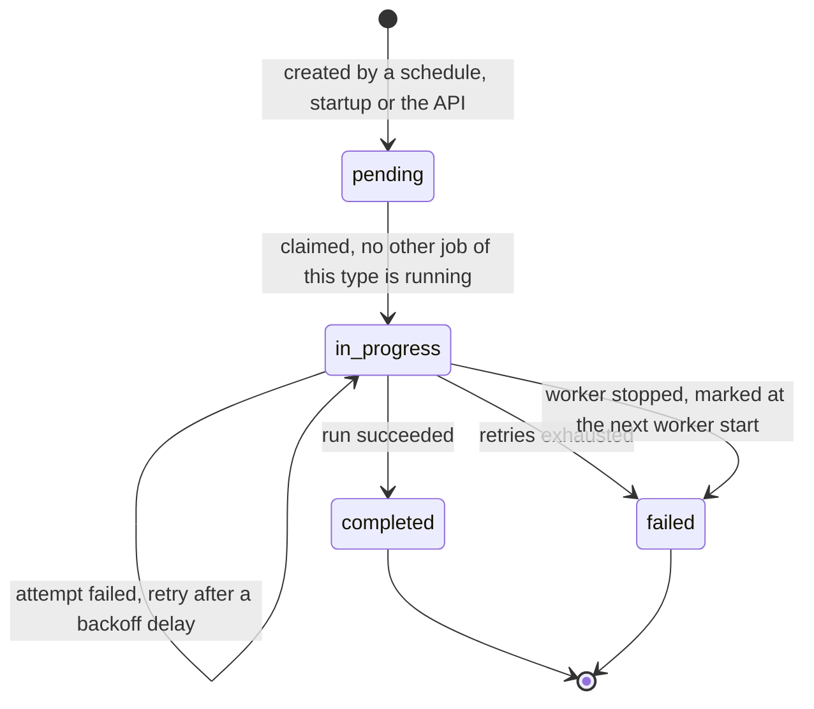

# Jobs module

Background work for the platform. Every run is stored as a row in the `jobs` table, so its status, attempts, result and error can be read through the API.

## Supported jobs

| Type              | What it does                                                                                    | Result                                                       | Default schedule | Runs on startup |
| ----------------- | ----------------------------------------------------------------------------------------------- | ------------------------------------------------------------ | ---------------- | --------------- |
| `sync-printers`   | Fetches printers from the vendor and creates, updates or deletes local printers to match.       | `counts` plus the `created`, `updated` and `deleted` records | every minute     | yes             |
| `sync-labels`     | Fetches labels from the vendor and creates, updates or deletes local labels to match.           | `counts` plus the `created`, `updated` and `deleted` records | every 5 minutes  | yes             |
| `backfill-prints` | Finds prints with no linked printer and links them by printer name to a matching local printer. | `{ updated }` list of the prints that were linked            | every minute     | no              |

The sync jobs return the counts and the records that changed, as stored in the database:

```json
{
  "counts": { "created": 1, "deleted": 0, "updated": 0 },
  "created": [{ "id": "…", "name": "Office Printer", "model": "HP LaserJet Pro" }],
  "deleted": [],
  "updated": []
}
```

## How a job is triggered

- **Schedule:** a cron expression per job type.
- **Startup:** the sync jobs also run once when the worker starts.
- **API:** `POST /api/v1/jobs` with `{ "type": "<job type>" }` creates a pending job and returns 202. The worker checks for these every second and runs them.

## Job lifecycle



## Behaviour to know

- **One run per job type:** a job can only be claimed if no job of the same type is `in_progress`. The check is made in the database, so it also holds across worker processes.
- **Retries:** a failed attempt is retried with exponential backoff, up to a maximum number of attempts. The defaults are 5 attempts, starting at 1 second, doubling each time, capped at 60 seconds. The `attempts` field counts them.
- **Interrupted jobs:** when the worker starts, any job still `in_progress` is marked `failed` with the error "Previous worker stopped before completing the job".
- **Shutdown:** on SIGTERM the worker stops its timers and waits for running jobs to finish before the database closes.
