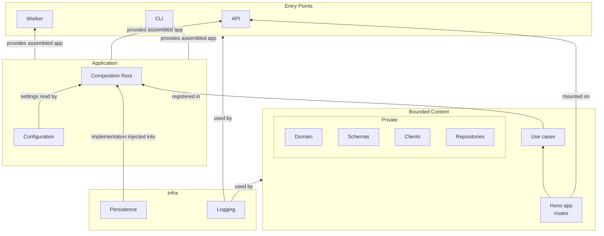

# Labeling Platform - Backend Architecture

## Concrete view

Same structure as above, with the real contexts, interfaces (rounded boxes) and persistence dialects.

```mermaid
flowchart BT
    subgraph entry["Entry Points"]
        API["API<br/>Hono"]
        Worker["Worker<br/>registers scheduled jobs<br/>sync-printers, sync-labels<br/>backfill-prints"]
    end

    subgraph app["Application"]
        CR["Composition Root"]
        LOOK["Print lookups adapter"]
        CONFIG["Configuration<br/>env vars"]
    end

    subgraph bounded["Bounded Contexts"]
        subgraph printers["Printers"]
            PHONO["Hono app<br/>routes"]
            PUC["Use cases<br/>sync, getPrinters, getPrinter<br/>getVendorPrinters<br/>applyPrinterChanges<br/>create, update, delete"]
            PREPO(["Repository"])
            PCLI(["Vendor client"])
            PMOCK["Mock client"]
        end
        subgraph labels["Labels"]
            LHONO["Hono app<br/>routes"]
            LUC["Use cases<br/>sync, getLabels, getLabel<br/>getVendorLabels<br/>applyLabelChanges<br/>create, update, delete"]
            LREPO(["Repository"])
            LCLI(["Vendor client"])
            LMOCK["Mock client"]
        end
        subgraph prints["Prints"]
            PRHONO["Hono app<br/>routes"]
            PRUC["Use cases<br/>print<br/>backfillPrints<br/>getPrints, getPrint"]
            PRREPO(["Repository"])
            PRCLI(["Vendor client"])
            PRMOCK["Mock client"]
            PRLOOK(["Printer and label lookups"])
        end
        subgraph jobs["Jobs"]
            JHONO["Hono app<br/>routes"]
            JWORKER["Jobs worker (worker.ts)<br/>cron scheduler<br/>API-job polling<br/>retries + crash recovery"]
            JUC["Use cases<br/>createJobs, getJobs<br/>claimNextJob<br/>updateJobs, deleteJobs"]
            JREPO(["Repository"])
        end
    end

    subgraph infra["Infra"]
        UOW(["Unit of Work"])
        PG["PostgreSQL<br/>repositories + Unit of Work"]
        SQLITE["SQLite<br/>repositories + Unit of Work"]
        LOGGING["Logging"]
    end

    app -->|"provides wired use cases"| API
    app -->|"provides wired use cases"| Worker
    JWORKER -->|"started by"| Worker
    Worker -.->|"scheduled jobs run sync and backfill use cases"| bounded
    JWORKER --> JUC

    bounded -->|"registered in"| CR
    LOOK -->|"implements"| PRLOOK
    LOOK -.->|"calls"| PUC
    LOOK -.->|"calls"| LUC

    PHONO -->|"mounted on"| API
    LHONO -->|"mounted on"| API
    PRHONO -->|"mounted on"| API
    JHONO -->|"mounted on"| API
    PHONO --> PUC
    LHONO --> LUC
    PRHONO --> PRUC
    JHONO --> JUC

    PUC --> PREPO
    PUC --> PCLI
    LUC --> LREPO
    LUC --> LCLI
    PRUC --> PRREPO
    PRUC --> PRCLI
    PRUC --> PRLOOK
    JUC --> JREPO

    PMOCK -.->|"implements"| PCLI
    LMOCK -.->|"implements"| LCLI
    PRMOCK -.->|"implements"| PRCLI
    PG -.->|"implements repositories"| bounded
    SQLITE -.->|"implements repositories"| bounded
    PG -.->|"implements"| UOW
    SQLITE -.->|"implements"| UOW

    UOW -->|"injected into"| CR
    CONFIG -->|"selects dialect, schedules, ports"| CR
    LOGGING -->|"used by"| entry
```

Arrows without a label mean "depends on" (a use case depends on the interface next to it).
