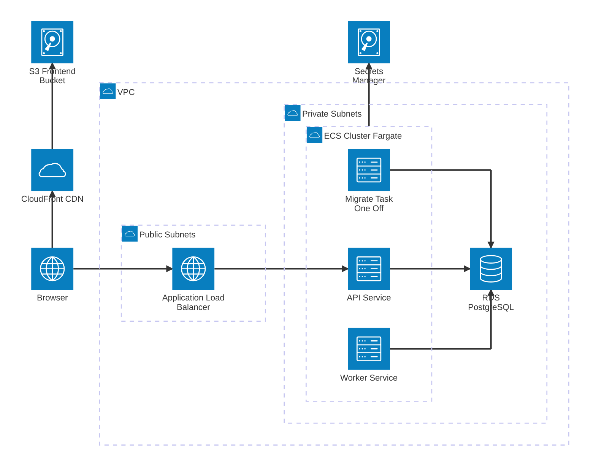
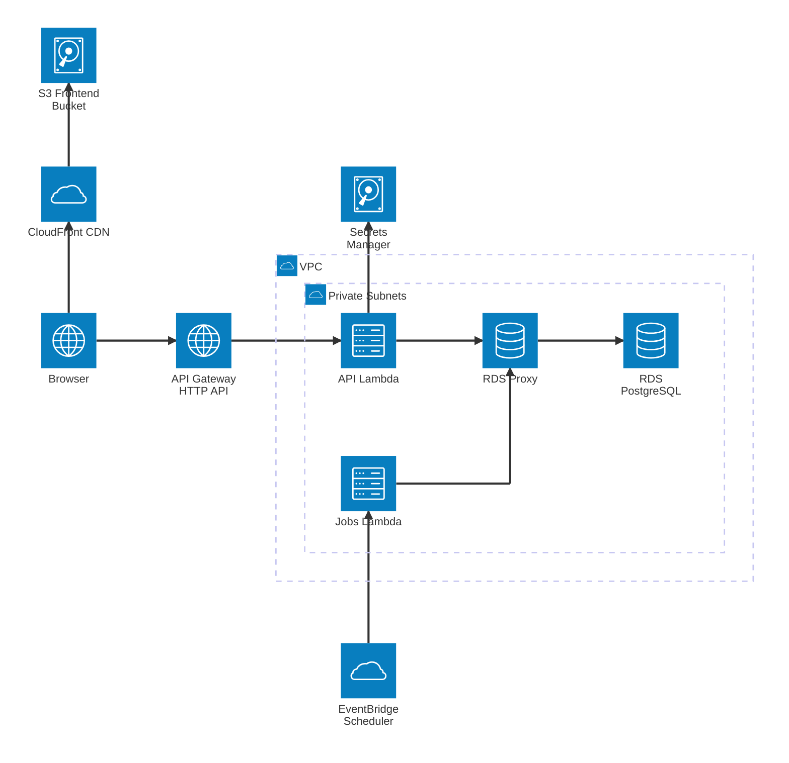

# Labeling Platform - AWS Deployment Options

## Option 1: ECS (Fargate) + RDS + S3/CloudFront

## Option 2: Lambda + API Gateway + EventBridge + RDS

The API runs as a Lambda function behind API Gateway. The three scheduled jobs (`sync-printers`, `sync-labels`, `backfill-prints`) are triggered by EventBridge Scheduler, which invokes a jobs Lambda. There are no always-on containers. The frontend stays on S3 + CloudFront and the database is still RDS PostgreSQL.

